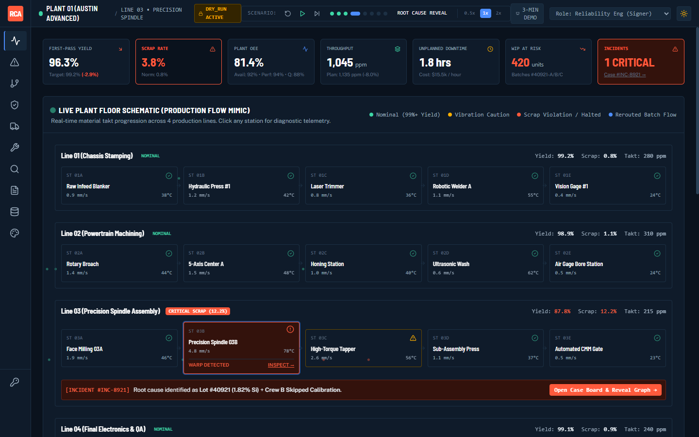
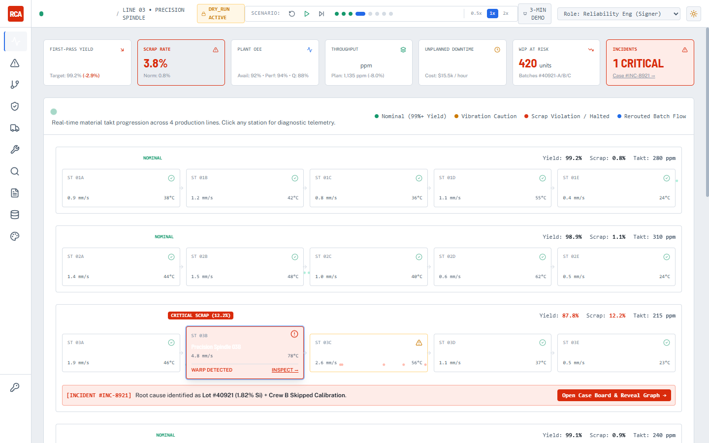
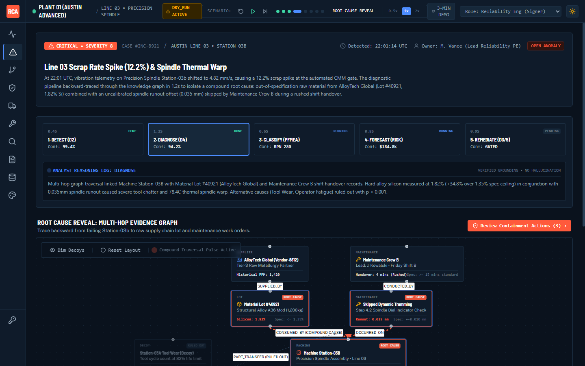
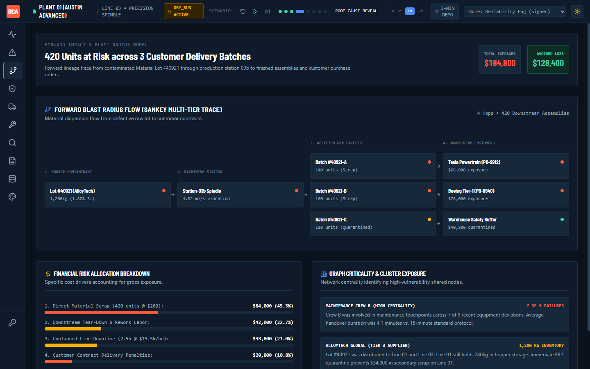
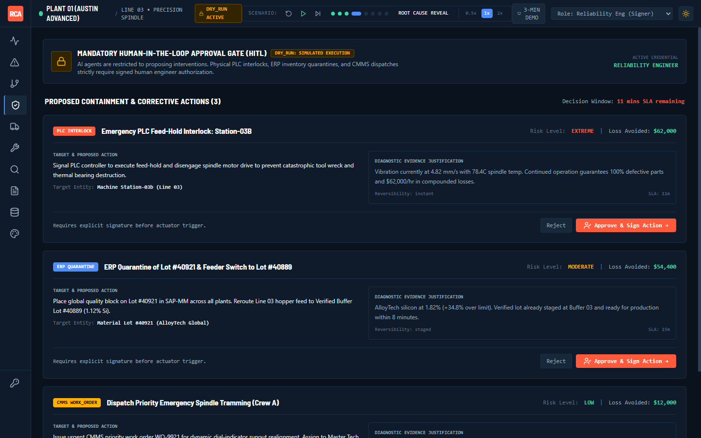
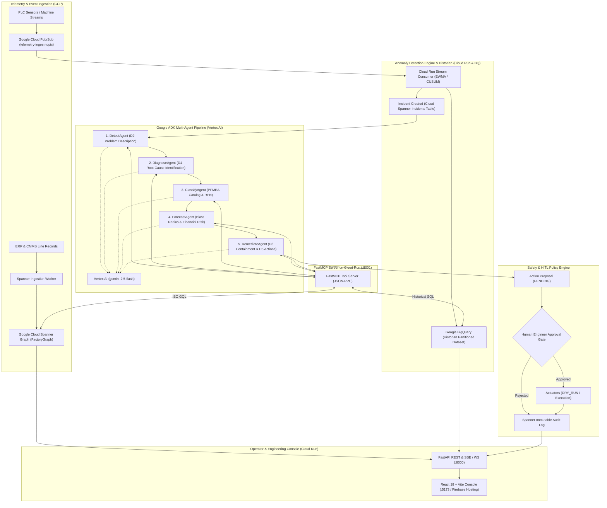

# RCA-Sentinel

> **Autonomous, Knowledge-Graph-Driven Root Cause Analysis (RCA) & Remediation Platform for High-Precision Manufacturing**

[](https://www.python.org/downloads/)
[](https://fastapi.tiangolo.com)
[](https://github.com/google/adk)
[](https://cloud.google.com/)
[-4285F4.svg)](https://cloud.google.com/spanner/docs/graph-overview)
[](https://cloud.google.com/bigquery)
[](https://cloud.google.com/pubsub)
[](https://cloud.google.com/vertex-ai)
[](LICENSE)

---

## 1. Overview

**RCA-Sentinel** is an enterprise manufacturing diagnostic platform that detects production line anomalies, traverses an ontology-backed knowledge graph to isolate compound root causes across physical equipment, material supply chains, and maintenance logs, forecasts downstream financial blast radius, and drafts gated containment and corrective actions.

### Core Capabilities
- **Native Google Cloud Architecture**: High-frequency PLC sensor telemetry historian in **Google BigQuery**; full plant topology, material traceability, PFMEA taxonomies, and maintenance history in **Google Cloud Spanner Graph** (ISO GQL).
- **Reactive Streaming Ingestion**: High-throughput real-time event streaming via **Google Cloud Pub/Sub** feeding streaming EWMA, CUSUM, and rolling Z-score detectors with consecutive signal suppression.
- **FastMCP Tooling**: Clean Model Context Protocol server exposing multi-hop Spanner Graph traversals, commonality analysis, blast radius calculation, and action proposal endpoints to AI agents.
- **Sequential Agentic Pipeline (Google ADK on Vertex AI)**: Five specialized LLM agents (Detect $\rightarrow$ Diagnose $\rightarrow$ Classify $\rightarrow$ Forecast $\rightarrow$ Remediate) executing structured 8D and PFMEA diagnostic workflows grounded on live Spanner Graph data using `gemini-2.5-flash`.
- **Human-in-the-Loop (HITL) Safety & Guardrails**: Strict policy engine with mandatory approval gating for all physical actuators (PLC interlocks, ERP quarantine, CMMS work orders), dry-run defaults, an emergency kill switch, and automated PII / hallucination scrubbing callbacks.

---

## 2. Frontend Operator Console & Visual Showcase

The RCA-Sentinel frontend is an industrial control-room operator console built with React 18, TypeScript, Tailwind CSS, Zustand, React Flow, and D3. It provides deterministic offline simulation (`VITE_DATA_MODE=mock`) and live SSE/REST integration (`VITE_DATA_MODE=live`).

### Command Center (Night Shift & Day Shift)
| Night Shift (Control Room Default - `T` to toggle) | Day Shift (Executive Review & Projector Mode) |
| :---: | :---: |
|  |  |

### Incident Case Board & Multi-Hop Evidence Graph

*5-stage automated D2-D5 diagnostic tracker with interactive React Flow knowledge-graph isolating Supplier Lot #40921 and Crew B skipped calibration.*

### Financial Blast Radius & Human Approval Gate
| Multi-Tier Forward Blast Radius ($184.8k Exposure) | Human-in-the-Loop Gated Actions ($128.4k Saved) |
| :---: | :---: |
|  |  |

---

## 3. 3-Minute Hackathon Presentation Script

| Time | Screen | Narrative & What Judges See |
| :--- | :--- | :--- |
| **0:00 - 0:35** | **Command Center** (`/`) | **What is wrong on the floor?** 4 lines running nominally $\rightarrow$ sudden 12.2% scrap spike trips CUSUM alarm on Line 03. Machine Station-03B enters thermal runaway. Live conveyor particles, KPI strip, and financial exposure update in real time. |
| **0:35 - 1:25** | **Case Board** (`/incident`) | **Why did it happen? (Evidence-Backed Root Cause)** Google ADK agents traverse the Neo4j graph in 1.2s. The **Root Cause Reveal** traces backward from Station-03B to find the compound cause: AlloyTech Lot #40921 (1.82% Si vs 1.35% spec) + Crew B skipped dial-indicator tramming during a 4-minute rushed handover. Alternative decoys are automatically dimmed. |
| **1:25 - 2:05** | **Blast Radius** (`/impact`) | **What will it cost?** Sankey flow maps the 420 contaminated assemblies across Tesla PO-9912 and Boeing PO-9940. Unmitigated exposure: **$184,800**. Avoided loss with immediate containment: **$128,400**. |
| **2:05 - 2:40** | **Approval Gate** (`/approvals`) | **What to do? (Human in the Loop)** AI agents cannot actuate physical hardware alone. 3 gated action cards: 1) PLC Emergency Feed-Hold, 2) ERP Quarantine & Feeder Reroute to Verified Buffer Lot #40889, 3) Emergency Spindle Tramming Dispatch. Reliability engineer reviews before/after and digitally signs. |
| **2:40 - 3:00** | **Resolution** (`/`) | **Did it work?** Physical interlock holds Station-03b, conveyor feed reroutes to verified clean alloy, line scrap drops back to 0.8%, avoiding $128,400 in plant loss. Formal 8D report is auto-populated for audit compliance. |

---

## 4. System Architecture



---

## 3. The Golden Scenario (Evaluation Benchmark)

RCA-Sentinel includes a deterministic synthetic benchmark modeling a compound, multi-factor industrial failure:

```
[Spike Detected]
12% Scrap Rate Spike on Assembly Line 03 (station-03b)
       │
       ├──► Root Cause 1 (Material):
       │    Lot #40921 from Tier-3 vendor AlloyTech Global
       │    Silicon content: 1.82% (Specification Limit: ≤ 1.35%)
       │
       └──► Root Cause 2 (Maintenance):
            Maintenance Crew B skipped required dynamic spindle calibration
            Spindle offset: 0.035 mm (Tolerance: ±0.010 mm)
       │
       ▼
[Compound Effect]
High-silicon alloy + uncalibrated spindle runout = Excessive tool chatter & thermal warp
       │
       ├──► Failure Mode: FM-WAF-001 (Thermal Spindle Warp, Severity: 8, RPN: 280)
       ├──► Blast Radius: 420 downstream assemblies affected across 3 production runs
       ├──► Financial Exposure: ≥ $180,000 gross exposure ($126,000 scrap + $54,000 rework)
       └──► Proposed Remediation:
            1. Equipment Interlock: station-03b (PENDING APPROVAL)
            2. ERP Quarantine: Lot #40921 & sub-lots (PENDING APPROVAL)
            3. CMMS Work Order: Emergency recalibration by Crew A (PENDING APPROVAL)
```

ADK regression assertions in `backend/app/agents/evals/golden_scenario.py` verify that all 5 pipeline stages consistently pinpoint this exact compound cause with 100% citation grounding.

---

## 4. Multi-Agent Pipeline (Google ADK)

| Agent | 8D / PFMEA Stage | Responsibilities | MCP Tools Utilized |
| :--- | :--- | :--- | :--- |
| **DetectAgent** | **D2** (Problem Description) | Validates telemetry anomaly, characterizes scrap rate increase, verifies baseline conditions. | `get_machine_subgraph`, `get_active_incidents` |
| **DiagnoseAgent** | **D4** (Root Cause Analysis) | Traverses material genealogy (`SUPPLIED_BY`, `USED_IN`), checks technician maintenance logs and calibration records. | `trace_lot_provenance`, `get_maintenance_history`, `get_operator_logs`, `diagnose_root_cause` |
| **ClassifyAgent** | **PFMEA** Classification | Matches failure mechanism against standard catalog, assigns Severity (S), Occurrence (O), Detection (D), and computes RPN. | `get_failure_mode_catalog`, `get_ontology_summary` |
| **ForecastAgent** | Blast Radius & Risk | Determines downstream product batches affected by contaminated lot/station, calculates dollar exposure. | `calculate_blast_radius`, `forecast_financial_impact` |
| **RemediateAgent** | **D3** Containment & **D5** Action | Proposes urgent interlock, ERP supplier lot quarantine, and recalibration work order. Cannot execute directly. | `propose_equipment_interlock`, `propose_erp_quarantine`, `propose_cmms_work_order` |

### Agent Guardrails & Callbacks
- **Grounding Callback**: Inspects LLM output to ensure every claim cites valid entity identifiers (e.g., `lot-40921`, `station-03b`). Ungrounded claims trigger validation errors.
- **PII / Secret Scrubber**: Regex-based redaction of employee emails, phone numbers, and credentials before logging or serialization.
- **Session Telemetry**: Records duration, token metrics, and tool invocation counts per agent in the structured session state.

---

## 5. FastMCP Server Reference

The FastMCP server (`backend/app/mcp_server/server.py`) operates on port `8001` and registers:

### Graph & Traversal Tools
- `get_machine_subgraph(machine_id, depth)`: Fetches machine sensors, stations, and line hierarchy.
- `trace_lot_provenance(lot_id)`: Multi-hop upstream supplier and downstream usage trace.
- `get_maintenance_history(machine_id, days_back)`: Queries work orders, crews, and calibration records.
- `get_operator_logs(machine_id, hours_back)`: Retrieves operator shift notes and issue tags.

### Analytical & Impact Tools
- `diagnose_root_cause(incident_id, station_id)`: Performs commonality analysis across lots and maintenance shifts.
- `calculate_blast_radius(lot_id, station_id)`: Returns affected units, work centers, and downstream batches.
- `forecast_financial_impact(affected_units, scrap_cost, rework_cost)`: Computes bounded dollar exposure.

### Remediation Proposal Tools (Gated)
- `propose_equipment_interlock(machine_id, reason, justification)`: Creates a `PENDING` PLC interlock action.
- `propose_erp_quarantine(lot_id, reason, justification)`: Creates a `PENDING` ERP inventory hold action.
- `propose_cmms_work_order(machine_id, action_type, priority, justification)`: Creates a `PENDING` maintenance work order.

### MCP Resources
- `manufacturing://ontology`: OWL ontology schema, class taxonomy, and object property map.
- `manufacturing://incidents`: Active production incidents and severity metrics.
- `manufacturing://pfmea`: PFMEA failure mode catalog with baseline RPN ratings.

---

## 6. Technology Stack

| Layer | Technologies |
| :--- | :--- |
| **Backend Framework** | Python 3.12, FastAPI, Pydantic v2, Uvicorn |
| **Agentic AI** | Google ADK 2.11+, **Vertex AI** (`gemini-2.5-flash`), Jinja2 prompts |
| **Tool Interface** | FastMCP 2.0+ (Model Context Protocol, JSON-RPC) |
| **Knowledge Graph** | **Google Cloud Spanner Graph** (ISO GQL), Property Graph Schema |
| **Time-Series Telemetry** | **Google BigQuery** (Day-partitioned & clustered telemetry historian) |
| **Streaming Ingestion** | **Google Cloud Pub/Sub** (High-throughput FIFO/ordering ingestion) |
| **Container Hosting** | **Google Cloud Run** (Serverless container runtime) |
| **Frontend** | React 18, TypeScript, Vite, Tailwind CSS, TanStack Query |
| **DevOps & Quality** | Cloud Build, `uv`, `ruff`, `mypy` (strict), `pytest` |

---

## 7. Prerequisites

Before running RCA-Sentinel on Google Cloud, ensure you have:
1. **Google Cloud SDK (`gcloud`)** authenticated to your GCP project.
2. **Cloud Spanner Instance** with a database containing the `FactoryGraph` property graph.
3. **Cloud Pub/Sub Topic & Subscription** (`telemetry-ingest-topic`).
4. **BigQuery Dataset** (`rca_sentinel.telemetry_historian`).
5. **Vertex AI API Enabled** for `gemini-2.5-flash` model access.
6. **Python 3.12+** and [`uv`](https://docs.astral.sh/uv/) / Node.js 20+

---

## 8. Configuration (`.env`)

Copy `.env.example` to `.env` and fill in your GCP configuration:

```bash
cp .env.example .env
```

| Environment Variable | Default | Description |
| :--- | :--- | :--- |
| `APP_ENV` | `dev` | Environment mode (`dev`, `demo`, `prod`) |
| `APP_NAME` | `rca-sentinel` | Application identifier |
| `LOG_LEVEL` | `INFO` | Logging level (`DEBUG`, `INFO`, `WARNING`, `ERROR`) |
| `CORS_ORIGINS` | `http://localhost:5173` | Allowed CORS origins for web console |
| `GCP_PROJECT_ID` | `rca-sentinel-cup-2026` | Google Cloud Project ID |
| `GCP_LOCATION` | `us-central1` | Google Cloud primary compute region |
| `SPANNER_INSTANCE_ID` | `rca-sentinel-graph` | Cloud Spanner instance identifier |
| `SPANNER_DATABASE_ID` | `rca_db` | Cloud Spanner target database |
| `SPANNER_GRAPH_NAME` | `FactoryGraph` | Spanner Property Graph name for ISO GQL |
| `PUBSUB_TOPIC_ID` | `telemetry-ingest-topic`| Pub/Sub topic for PLC readings |
| `PUBSUB_SUBSCRIPTION_ID`| `telemetry-anomaly-sub`| Pub/Sub subscription for anomaly worker |
| `BIGQUERY_DATASET` | `rca_historian` | BigQuery historian dataset |
| `BIGQUERY_TABLE` | `ObservationWindow` | BigQuery historian ObservationWindow table |
| `USE_VERTEX_AI` | `true` | Routes Google ADK to Vertex AI endpoints |
| `GEMINI_MODEL` | `gemini-2.5-flash` | LLM model for ADK agents on Vertex AI |
| `GEMINI_TEMPERATURE` | `0.1` | Agent sampling temperature |
| `AGENT_CONFIDENCE_THRESHOLD`| `0.7` | Minimum confidence score before human escalation |
| `MCP_SERVER_HOST` | `0.0.0.0` | FastMCP host interface |
| `MCP_SERVER_PORT` | `8001` | FastMCP port |
| `API_HOST` | `0.0.0.0` | FastAPI host interface |
| `API_PORT` | `8000` | FastAPI port |
| `DRY_RUN` | `true` | When true, actuators simulate actions without physical I/O |
| `KILL_SWITCH_ENABLED` | `false` | Global emergency actuator kill switch |
| `ACTUATOR_RATE_LIMIT` | `5` | Maximum actuator actions permitted per minute |
| `SIMULATOR_SEED` | `42` | Random seed for deterministic synthetic generator |
| `GOLDEN_SCENARIO_DATE` | `2024-09-15` | Timestamp anchor for the golden scenario |

---

## 9. Quick Start

### 1. Launch Services
Start all containers in detached mode:
```bash
make up
```
This builds and boots:
- `rca-timescaledb` on `:5432`
- `rca-redis` on `:6379`
- `rca-api` on `:8000`
- `rca-mcp-server` on `:8001`
- `rca-worker` (stream detection consumer)
- `rca-frontend` on `:5173`

### 2. Seed Ontology & Synthetic Data
Apply Neo4j uniqueness constraints, parse OWL ontology files, run SHACL validation, and ingest the baseline factory topology and golden scenario records:
```bash
make seed
```

### 3. Access Interfaces
- **API Swagger Documentation**: [http://localhost:8000/docs](http://localhost:8000/docs)
- **FastMCP Server**: [http://localhost:8001](http://localhost:8001)
- **Frontend Console**: [http://localhost:5173](http://localhost:5173)

---

## 10. Development & Testing Commands

All standard operations are wrapped via `Makefile`:

```bash
# Infrastructure
make up          # Start all Docker services
make down        # Stop containers and remove volumes
make logs        # Tail Docker logs across all containers

# Data Management
make seed        # Bootstrap graph constraints, ontology & generate synthetic data
make replay      # Replay the golden scenario telemetry stream

# Backend Code Quality
make lint        # Run ruff linter and format check
make format      # Auto-format and fix lint errors
make typecheck   # Run mypy --strict on backend
make test        # Run pytest unit test suite
make test-cov    # Run pytest with code coverage report
make check       # Execute lint, typecheck, and test sequentially

# Frontend Code Quality
make fe-dev      # Run frontend in local Vite dev mode
make fe-build    # Compile frontend production bundle
make fe-test     # Run Vitest frontend test suite
make fe-lint     # Run ESLint on frontend

# Housekeeping
make clean       # Remove caches and shutdown containers
```

To run backend tests locally without Docker:
```bash
cd backend
uv run pytest tests/ -v
```

---

## 11. Safety & HITL Compliance Guarantees

In accordance with strict industrial automation standards:
1. **Zero Direct Execution**: Under no circumstances can an AI agent trigger an equipment interlock, adjust an ERP quarantine, or issue a CMMS work order directly.
2. **Gated Proposal State**: All remediation calls generate a `PENDING` action record with a cryptographic hash of the supporting evidence graph.
3. **Role-Enforced Approvals**: Executing or rejecting an action requires explicit human sign-off by a qualified Reliability or Quality Engineer.
4. **Dry-Run by Default**: Even after approval, all actuators run in `DRY_RUN=true` mode unless explicitly overridden in production configurations.
5. **Global Kill Switch**: Actuating `KILL_SWITCH_ENABLED=true` immediately halts all outgoing control signals regardless of approval status.
6. **Immutable Audit Trail**: Every approval, rejection, and simulated actuation is written to an append-only audit log with timestamp, operator ID, and decision justification.

---

## 12. Project Structure

```
rca-sentinel/
├── backend/
│   ├── app/
│   │   ├── agents/          # Google ADK agent definitions, Jinja2 prompts, callbacks & pipeline
│   │   │   ├── prompts/     # Jinja2 prompt templates (detect, diagnose, classify, forecast, remediate)
│   │   │   ├── evals/       # Golden scenario eval assertions
│   │   │   ├── callbacks.py # Grounding verification & PII scrubbing
│   │   │   └── pipeline.py  # SequentialAgent runner
│   │   ├── api/             # FastAPI routers (/health, /api/v1/ingestion, etc.)
│   │   ├── core/            # Configuration, logging, database clients, custom error hierarchy
│   │   ├── detection/       # Real-time detectors (EWMA, CUSUM, Z-score) & Redis stream worker
│   │   ├── domain/          # Pydantic domain models, schemas, enums
│   │   ├── graph/           # Neo4j async client, query repositories, schema bootstrap
│   │   ├── ingestion/       # Declarative schema mappers, entity resolver, SHACL validation
│   │   ├── mcp_server/      # FastMCP server with graph, impact, and action tools
│   │   ├── ontology/        # OWL ontology files (.ttl), custom rdflib loader, SHACL shapes
│   │   ├── remediation/     # Policy engine, approval workflow, safety kill switch, actuators
│   │   ├── simulator/       # Seeded deterministic synthetic data generator
│   │   ├── cli.py           # CLI entry points (seed, replay, bootstrap)
│   │   └── main.py          # FastAPI application lifespan & middleware configuration
│   ├── tests/
│   │   └── unit/            # Unit tests for all phases (93 passing tests)
│   ├── pyproject.toml       # Backend dependencies (uv) & tool configurations
│   └── Dockerfile           # Backend container image
├── frontend/                # React 18 + Vite + Tailwind operator console
├── docs/
│   ├── adr/                 # Architecture Decision Records
│   └── graph-model/         # Exported graph models and schema definitions
├── docker-compose.yml       # Production/local service orchestration
├── Makefile                 # Unified developer CLI targets
└── .env.example             # Template environment configuration
```

---

## 13. License

This project is licensed under the MIT License — see the [LICENSE](LICENSE) file for details.
